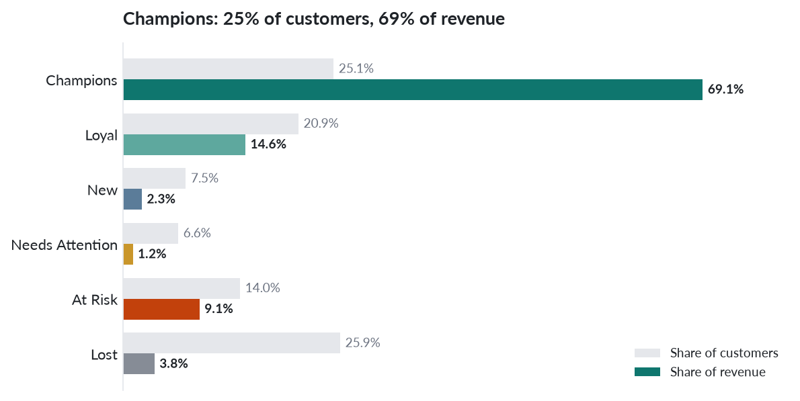

# Customer Segmentation & Churn Analytics: UK Online Retailer

This project applies RFM segmentation and a 90-day churn flag to two years of real transactions from a UK online giftware retailer. SQL cleans and validates the data in PostgreSQL. Python scores and segments customers. The results feed a three-page Power BI dashboard.

**Headline numbers:**
- **Champions** are 25.1% of customers but bring in **69.1% of revenue** (£12.0m of £17.4m).
- **Churn:** 50.9% of customers made no purchase in the last 90 days.
- **At Risk:** 821 customers who used to buy often hold **£1.59m** of past revenue.

## Business problem
The retailer wants to know which customers are most valuable, and to reduce churn among those at risk of leaving.

1. Who are the most valuable customers, and how much revenue do they bring?
2. Which customers have gone quiet and are at risk of churning?
3. How do customer value and retention change by month, quarter and year?
4. How do customer value and churn differ by country?
5. What concrete action should the business take for each customer segment?

## Data
**Online Retail II**, from the [UCI Machine Learning Repository](https://archive.ics.uci.edu/dataset/502/online+retail+ii), donated by Daqing Chen. Licensed under [CC BY 4.0](https://creativecommons.org/licenses/by/4.0/).
- Real, anonymised transactions of a UK-based non-store online retailer of all-occasion giftware, many of whose customers are wholesalers.
- 1 Dec 2009 to 9 Dec 2011, 1,067,371 rows over two sheets.
- Columns: Invoice, StockCode, Description, Quantity, InvoiceDate, Price, Customer ID, Country.
- Currency: GBP.

Download and file details: [data/README.md](data/README.md).

## Tech stack
| Layer | Tool |
|---|---|
| Storage, cleaning, exploration | PostgreSQL 16 (Docker `postgres:16-alpine`), pgAdmin 4 |
| Analysis | Python 3.12: pandas, NumPy, Matplotlib, SQLAlchemy + psycopg2 (reads and writes Postgres directly) |
| Notebook | Jupyter |
| Dashboard | Power BI Desktop + DAX |
| Versioning | Git + GitHub |

## Workflow
```
online_retail_II.xlsx
  └─ scripts/xlsx_to_csv.py  ── two Latin-1 CSVs (COPY cannot read .xlsx)
       └─ sql/01_load.sql     ── retail_raw (1,067,371 rows, verified)
            └─ sql/02_clean.sql ── retail_clean (779,425 rows) + cleaning_log
                 ├─ sql/03_explore.sql ── time, country, top customers, AOV, retention
                 └─ notebooks/rfm_segmentation.ipynb
                      └─ customer_rfm, segment_rules, analysis_ready ── Power BI
```

| Path | Contents |
|---|---|
| [docs/BRD.md](docs/BRD.md) | Requirements, definitions, assumptions, success criteria |
| [sql/](sql/) | Load, clean and explore scripts |
| [notebooks/rfm_segmentation.ipynb](notebooks/rfm_segmentation.ipynb) | RFM, segments, churn, charts, write-back |
| [powerbi/](powerbi/) | Data model and DAX, page layout spec, theme |
| [docs/findings.md](docs/findings.md) | Findings and actions |
| [docs/Walkthrough.md](docs/Walkthrough.md) | Full step-by-step explanation |
| [docs/outputs/](docs/outputs/) | Saved output of every script and the notebook |

## Cleaning decisions
Each step is logged to the `cleaning_log` table. The script fails if the counts don't reconcile from one step to the next.

| Step | Rows before | Rows after | Removed | Decision |
|---|---|---|---|---|
| 1 Cast types | 1,067,371 | 1,067,371 | 0 | Integers, numerics, and dates parsed from `DD-MM-YYYY HH24:MI` |
| 2 Remove exact duplicates | 1,067,371 | 1,033,036 | 34,335 | `ROW_NUMBER()` over all 8 columns. This also removes the 1–9 Dec 2010 overlap between the two sheets |
| 3 Flag cancellations / adjustments | 1,033,036 | 1,033,036 | 0 | 19,104 `C` and 6 `A` rows flagged |
| 4 Drop cancellations | 1,033,036 | 1,013,932 | 19,104 | Excluded rather than netted: many have no matching order in the window |
| 5 Drop adjustments | 1,013,932 | 1,013,926 | 6 | Bad-debt adjustments |
| 6 Drop quantity ≤ 0 | 1,013,926 | 1,010,533 | 3,393 | Zero-price stock corrections, none with a Customer ID |
| 7 Drop price ≤ 0 | 1,010,533 | 1,007,912 | 2,621 | No revenue |
| 8 Exclude missing Customer ID | 1,007,912 | 779,425 | 228,487 | Can't be attributed to a customer: £3,090,394.12, or 15.1% of purchase revenue. Kept in `retail_purchases` |
| 9 Add line revenue | 779,425 | 779,425 | 0 | `quantity * price` |

**Result:** 779,425 lines, 5,878 customers, 36,969 invoices, £17,374,804.27.

## RFM method and segment rules
- **Reference date:** 10 Dec 2011, the day after the last invoice.
- **Recency:** days since the customer's last purchase.
- **Frequency:** distinct invoices.
- **Monetary:** total revenue.
- **Scores:** each scored 1–5 by quintile (`pd.qcut`). Recency is reversed so that recent = 5. Frequency is ranked with `method='first'` before `qcut` to break ties.
- **Churned:** no purchase in the trailing 90 days (Recency > 90).

Segments come from the R and F scores. Rules are evaluated top-down and the first match wins, and every one of the 25 R×F cells maps to exactly one segment:

| Segment | R | F | Meaning |
|---|---|---|---|
| Champions | 4–5 | 4–5 | Bought recently and buy often |
| Loyal | 3–5 | 3–5 | Regular buyers, not top on both |
| New | 4–5 | 1–2 | Bought recently, few orders so far |
| Needs Attention | 3 | 1–2 | Middling recency, low frequency |
| At Risk | 1–2 | 3–5 | Used to buy often, now gone quiet |
| Lost | 1–2 | 1–2 | Last bought long ago, few orders |

## Key findings
| Segment | Customers | Revenue | Share | Churned |
|---|---|---|---|---|
| Champions | 1,476 | £12,001,386.40 | 69.1% | 0 |
| Loyal | 1,230 | £2,536,015.29 | 14.6% | 445 |
| New | 441 | £392,021.57 | 2.3% | 0 |
| Needs Attention | 388 | £205,137.22 | 1.2% | 201 |
| At Risk | 821 | £1,586,359.12 | 9.1% | 821 |
| Lost | 1,522 | £653,884.67 | 3.8% | 1,522 |

- **Concentration:** the top 10% of customers bring in 64.0% of revenue, and the top 1% bring in 32.0%.
- **Churn:** 2,989 customers (50.9%) are churned. Together they account for £3,391,383.66 of past revenue (19.5%).
- **Earliest warning:** 445 Loyal customers holding £1,051,620.05 have just passed 90 days without an order.
- **Revenue flat year on year:** Jan–Nov 2011 was −0.1% vs Jan–Nov 2010. November is the peak month in both years.
- **More returning customers, fewer new ones:** about 80% of 2011's active customers each quarter were returning buyers, but new customers per quarter fell from 778 (2010-Q4) to 440 (2011-Q4).
- **UK vs overseas:** the UK brings in 82.8% of revenue with a 51.2% churn rate. Overseas customers place orders twice the size (AOV £870.94 vs £429.00).

**Actions:**
- Personal win-back for the 97 high-spending At Risk customers (£832,906.23).
- Re-order outreach to the 445 lapsing Loyal customers.
- Second-order offer to the 237 one-order New customers.
- Account management for the 833 top-spending Champions.

Full detail is in [docs/findings.md](docs/findings.md).



## Dashboard
Three pages:
- **Home:** navigation and glossary.
- **Business Overview:** KPIs, monthly trend with a revenue/customers toggle, quarters, countries, new vs returning customers, top customers.
- **RFM Analysis:** segment value, R×F grid, churn by country, segment table with actions.

Built in Power BI Desktop from [powerbi/layout_spec.md](powerbi/layout_spec.md), [powerbi/dax_measures.md](powerbi/dax_measures.md) and [powerbi/theme.json](powerbi/theme.json).

Screenshots, once built (placeholders):

| Home | Business Overview | RFM Analysis |
|---|---|---|
| `docs/img/home.png` | `docs/img/overview.png` | `docs/img/rfm.png` |

## How to reproduce
Requirements: Docker, Conda, and about 2 GB of free disk space.

```bash
git clone https://github.com/ATHARVA-87/rfm-retention-analytics.git
cd rfm-retention-analytics
conda env create -f environment.yml && conda activate rfm
cp .env.example .env            # set PGPASSWORD
./run_all.sh                    # add --pgadmin for pgAdmin 4 at http://localhost:5050
```

`run_all.sh`:
1. starts PostgreSQL 16;
2. downloads the data;
3. runs the three SQL scripts and the notebook;
4. saves outputs to `docs/outputs/`;
5. writes `data/export/rfm_bi.dump` for Power BI.

On Windows, restore that dump into PostgreSQL 16 and import the three tables. See [powerbi/layout_spec.md](powerbi/layout_spec.md) §0.

## Credits
Data: Daqing Chen, Online Retail II, UCI Machine Learning Repository, CC BY 4.0.

Methodology inspired by Mansi Goel's public tutorial; rebuilt independently in PostgreSQL and Python.
